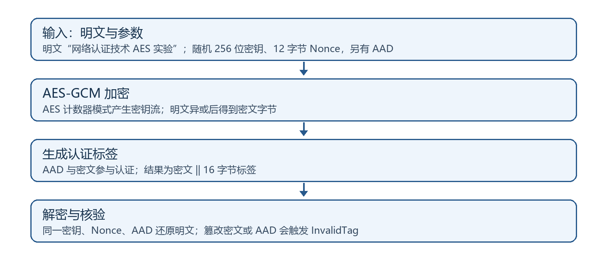
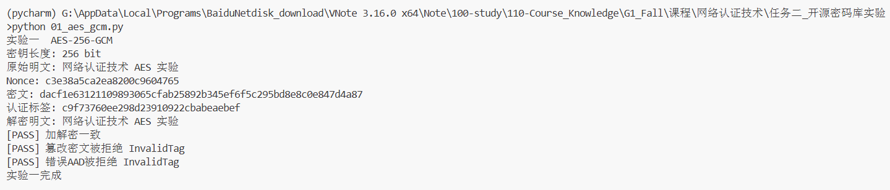
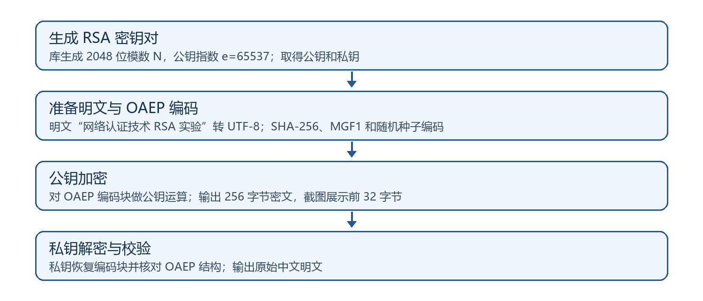
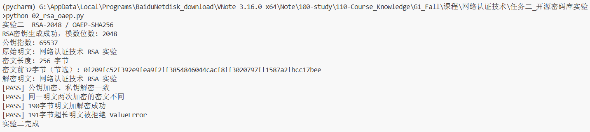
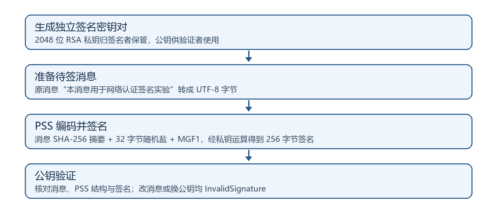
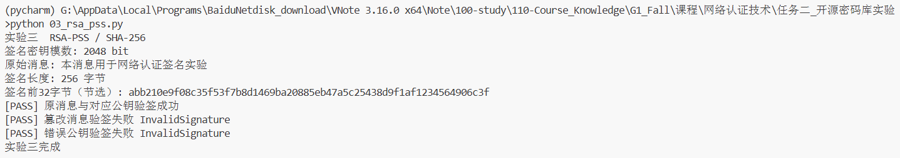
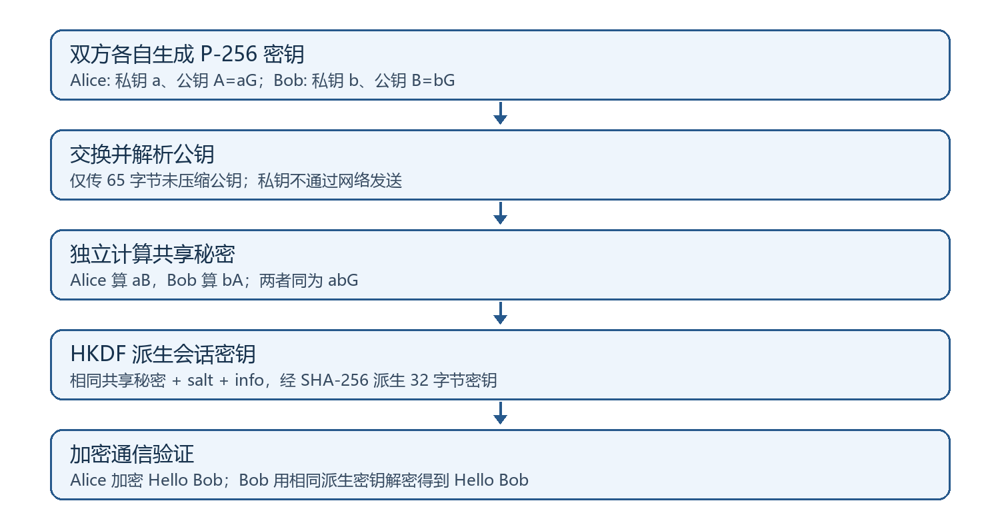
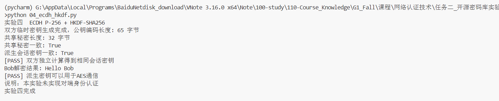
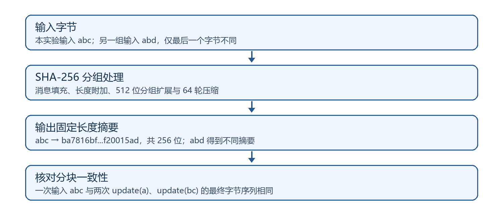
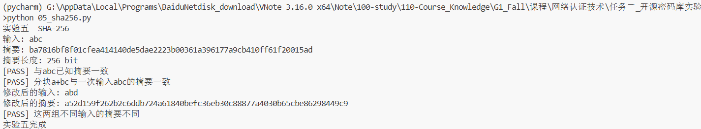

# 网络认证技术第一次作业：开源密码库实验报告

本报告按“环境—输入和参数—算法流程—源码—原始截图—结果分析”组织。代码中的密钥、Nonce、随机盐由程序在运行时生成，因此密文和签名的十六进制值每次可能不同；图中为本人直接运行所得的具体结果，正文不虚构固定密文。

## 一、实验环境与工具

### 1.1 软件库和程序语言

程序语言为 Python，开源密码库为 `cryptography 50.0.1`。本实验分别调用 `AESGCM`、`rsa` 与 `padding`、`ec`、`HKDF` 和 `hashes` 模块，实现对称加解密、RSA 密钥产生与加解密、数字签名/验证、密钥交换和 SHA-256 摘要。实验调用成熟库接口，不自行实现底层密码轮函数。五项功能分别放在五个独立源文件。

### 1.2 编译／运行环境

| 项目 | 实际环境 |
| --- | --- |
| 操作系统 | Windows；程序返回的平台标识为 `Windows-10-10.0.22631-SP0` |
| 开发与执行界面 | Visual Studio Code 集成终端，Anaconda 的 `pycharm` 环境 |
| Python 解释器 | `F:\AppData\Local\Programs\Anaconda_envs\envs\pycharm\python.exe` |
| 程序语言版本 | Python 3.10.20 |
| 软件库版本 | cryptography 50.0.1，`requirements.txt` 固定此版本 |
| 实验日期 | 2026 年 10 月 8 日 |

Python 源文件由解释器直接执行，没有传统 C/C++ 的独立编译和链接步骤。五张结果图均来自 `python 单项文件.py` 的直接运行，文件名以 `_1.png` 结尾；无后缀的截图只用来核对环境信息。报告中完整使用原图。

## 二、AES-256-GCM 对称加解密

### 2.1 输入、密钥与算法原理

**明文是什么：**`网络认证技术 AES 实验`，先编码成 UTF-8 字节。**密钥是什么：**程序随机生成的 256 位 AES 密钥；只有持有同一密钥的一方能正常解密。**其他参数：**每次运行随机生成 12 字节 Nonce，AAD 固定为 `course=network-auth;experiment=01`。AAD 保持可见，但被纳入认证。

AES 的 128 位分组经历字节替换、行移位、列混合和轮密钥加；AES-256 使用 14 轮，最后一轮不做列混合。GCM 再用 AES 加密计数器得到密钥流，明文字节与密钥流异或生成**密文字节**。程序实际输出的 `packet` 是“密文∥16 字节认证标签”，所以用 `packet[:-16]` 显示密文，用 `packet[-16:]` 显示标签。密文在截图中以十六进制输出，不再是可读中文；每次随机密钥和 Nonce 改变时数值也会改变。

解密端用相同密钥、Nonce 和 AAD 重新计算并核对标签，再恢复 `网络认证技术 AES 实验`。密文被改一个比特或 AAD 被替换时，标签核对失败，库抛出 `InvalidTag`。同一密钥下不能重复 Nonce，因为会重复密钥流并破坏 GCM 的安全性。[1][6]

### 程序源码

文件：`01_aes_gcm.py`。编号注释与流程图中的步骤对应，以下为实际保存的源码。

~~~python
"""实验一：AES-256-GCM 对称加解密。"""
import os
from cryptography.exceptions import InvalidTag
from cryptography.hazmat.primitives.ciphers.aead import AESGCM

# 1. 生成 256 位 AES 密钥和 12 字节随机 Nonce。
#    GCM 在同一密钥下不能重复使用 Nonce；本程序每次仅加密一次。
key = AESGCM.generate_key(bit_length=256)
nonce = os.urandom(12)  # 此密钥只加密一次，避免重复 nonce。
# 2. 准备 UTF-8 明文与只认证、不加密的附加数据 AAD。
message = "网络认证技术 AES 实验".encode("utf-8")
aad = b"course=network-auth;experiment=01"
# 3. 用密钥建立 AES-GCM 对象；encrypt 输出“密文 + 16 字节标签”。
cipher = AESGCM(key)
packet = cipher.encrypt(nonce, message, aad)
# 4. 使用相同密钥、Nonce、AAD 验证标签并解密。
recovered = cipher.decrypt(nonce, packet, aad)

# 5. 分别展示明文、密文、标签和解密结果，便于和截图核对。
print("实验一  AES-256-GCM")
print("密钥长度:", len(key) * 8, "bit")
print("原始明文:", message.decode())
print("Nonce:", nonce.hex())
print("密文:", packet[:-16].hex())
print("认证标签:", packet[-16:].hex())
print("解密明文:", recovered.decode())
if recovered != message:
    raise RuntimeError("加解密结果不一致")
print("[PASS] 加解密一致")

# 6. 翻转密文第一字节的一个比特；原标签不变，认证必须失败。
altered = bytes([packet[0] ^ 1]) + packet[1:]
try:
    cipher.decrypt(nonce, altered, aad)
except InvalidTag:
    print("[PASS] 篡改密文被拒绝 InvalidTag")
else:
    raise RuntimeError("错误：接受了篡改密文")
# 7. 仅替换 AAD；即使密文不变，标签核验仍应拒绝。
try:
    cipher.decrypt(nonce, packet, b"wrong-aad")
except InvalidTag:
    print("[PASS] 错误AAD被拒绝 InvalidTag")
else:
    raise RuntimeError("错误：接受了错误AAD")
print("实验一完成")
~~~

### 实验截图与观察

在 VS Code 集成终端直接执行 `python 01_aes_gcm.py`。下图为原始 `_1` 截图，未裁切、遮盖或重绘。

本次截图中的明文为 `网络认证技术 AES 实验`，密文为 `dacf1e63121109893065cfab25892b345ef6f5c295bd8e8c0e847d4a87`，认证标签为 `c9f73760ee298d23910922cbabeaebef`。这些是本次随机运行的具体输出，不是算法的固定结果。截图还给出 Nonce 和解密明文。解密明文与输入完全相同，两个篡改测试均被 `InvalidTag` 拒绝。这里的“加密后是什么”是截图所示的十六进制密文字节与 16 字节标签；它不是固定文本，不能用一次随机结果代替所有运行结果。

## 三、RSA-2048 密钥产生与 OAEP 加解密

### 3.1 密钥产生、输入与加解密原理

**密钥如何生成：**理论上先选不同大素数 `p,q`，算 `N=pq` 和 `φ(N)=(p−1)(q−1)`；选与 `φ(N)` 互素的公钥指数 `e`，求 `d` 使 `ed≡1 (mod φ(N))`。公钥是 `(N,e)`，私钥包含 `d` 等秘密参数。本实验让库生成 2048 位密钥，`e=65537`。由于 `ed=1+kφ(N)`，对合适的消息代表元有 `(M^e)^d≡M (mod N)`，因此公钥运算后的数据可由对应私钥恢复。

**明文是什么：**`网络认证技术 RSA 实验` 的 UTF-8 字节。RSA 不能把任意长文本直接代入幂运算；OAEP 先混入随机种子，使用 SHA-256 与 MGF1 生成有结构的编码块，再执行公钥运算。这样同一明文两次加密所得密文通常不同。私钥解密后还要检查 OAEP 结构，才能交付原明文。[2]

**加密后是什么：**2048 位模数对应 **256 字节密文**，程序输出其前 32 字节十六进制节选，完整密文保存在变量 `ciphertext`。这串字节不可直接读作中文；`private.decrypt` 才恢复原始明文。SHA-256 摘要长度为 32 字节，OAEP 明文上限为 `256−2×32−2=190` 字节，故代码验证 190 字节可加解密、191 字节被拒绝。

### 程序源码

文件：`02_rsa_oaep.py`。编号注释与流程图中的步骤对应，以下为实际保存的源码。

~~~python
"""实验二：RSA 密钥生成与 OAEP 加解密。"""
from cryptography.hazmat.primitives import hashes, serialization
from cryptography.hazmat.primitives.asymmetric import padding, rsa

# 1. 库内部生成两个大素数及 RSA 私钥，设置 2048 位模数和 e=65537。
private = rsa.generate_private_key(public_exponent=65537, key_size=2048)
# 2. 从私钥提取公钥，编码为 PEM 再载入，模拟公钥交给发送方。
pem = private.public_key().public_bytes(
    serialization.Encoding.PEM,
    serialization.PublicFormat.SubjectPublicKeyInfo)
public = serialization.load_pem_public_key(pem)

# 3. 统一加密与解密的 OAEP 参数：消息摘要和 MGF1 都选 SHA-256。
def oaep():
    return padding.OAEP(
        mgf=padding.MGF1(hashes.SHA256()),
        algorithm=hashes.SHA256(), label=None)

# 4. 把中文明文编码为 UTF-8 字节，再用接收方公钥随机化加密。
message = "网络认证技术 RSA 实验".encode("utf-8")
ciphertext = public.encrypt(message, oaep())
# 5. 由接收方私钥解密，并检查 OAEP 编码，恢复原始字节。
recovered = private.decrypt(ciphertext, oaep())
print("实验二  RSA-2048 / OAEP-SHA256")
print("RSA密钥生成成功，模数位数:", public.key_size)
print("公钥指数:", public.public_numbers().e)
print("原始明文:", message.decode())
print("密文长度:", len(ciphertext), "字节")
print("密文前32字节（节选）:", ciphertext[:32].hex())
print("解密明文:", recovered.decode())
if recovered != message:
    raise RuntimeError("RSA解密结果错误")
print("[PASS] 公钥加密、私钥解密一致")
# 6. 同一明文重新加密；比较两份密文，观察 OAEP 的随机性。
second = public.encrypt(message, oaep())
if second == ciphertext:
    raise RuntimeError("两次随机编码密文意外相同")
print("[PASS] 同一明文两次加密的密文不同")

# 7. 检验长度边界：2048 位模数为 256 字节，SHA-256 摘要为 32 字节。
#    OAEP 明文上限是 256 - 2*32 - 2 = 190 字节。
edge = public.encrypt(b"A" * 190, oaep())
if private.decrypt(edge, oaep()) != b"A" * 190:
    raise RuntimeError("边界测试失败")
print("[PASS] 190字节明文加解密成功")
try:
    public.encrypt(b"A" * 191, oaep())
except ValueError:
    print("[PASS] 191字节超长明文被拒绝 ValueError")
else:
    raise RuntimeError("错误：接受了超长明文")
print("实验二完成")
~~~

### 实验截图与观察

在 VS Code 集成终端直接执行 `python 02_rsa_oaep.py`。下图为原始 `_1` 截图，未裁切、遮盖或重绘。

截图显示密钥模数 2048 位、公钥指数 65537、密文长度 256 字节；本次密文前 32 字节为 `0f209fc52f392e9fea9f2ff3854846044cacf8ff3020797ff1587a2fbcc17bee`。完整 256 字节密文由程序保存在 `ciphertext` 中，截图只展示前缀。解密结果回到 `网络认证技术 RSA 实验`；同明文两次密文不同，190 字节成功，191 字节触发 `ValueError`。密文前缀以截图中的实测十六进制为准，随机生成使其不具固定值。

## 四、RSA-PSS 数字签名与验证

### 4.1 消息、签名密钥与验证原理

**签名消息是什么：**`本消息用于网络认证签名实验`。实验重新生成一对 2048 位 RSA 密钥，签名者保管私钥，验证者持有其可信公钥。签名用途是证明消息与私钥的对应关系和检测修改，不负责把消息加密成密文。

程序用 SHA-256 计算消息摘要，再在 PSS 编码中加入 32 字节随机盐，MGF1 也用 SHA-256，最后以私钥生成 **256 字节签名**。原消息和签名一起交给验证者。验证者用公钥核验 PSS 编码和重新计算的摘要；原消息通过，追加 `!` 后摘要改变而失败，换用另一把公钥也失败。签名程序输出前 32 字节十六进制节选；由于盐和密钥随机，签名值不是固定字符串。[2]

### 程序源码

文件：`03_rsa_pss.py`。编号注释与流程图中的步骤对应，以下为实际保存的源码。

~~~python
"""实验三：RSA-PSS 数字签名与验证。"""
from cryptography.exceptions import InvalidSignature
from cryptography.hazmat.primitives import hashes
from cryptography.hazmat.primitives.asymmetric import padding, rsa

# 1. 单独生成 2048 位签名密钥对，不复用加密实验中的私钥。
# 签名独立生成密钥，不复用加密实验的密钥。
private = rsa.generate_private_key(public_exponent=65537, key_size=2048)
public = private.public_key()

# 2. 设置 PSS 编码：MGF1 使用 SHA-256，随机盐固定为 32 字节。
def pss():
    return padding.PSS(
        mgf=padding.MGF1(hashes.SHA256()), salt_length=32)

# 3. 把待签消息编码为字节；sign 内部计算 SHA-256 摘要并用私钥签名。
message = "本消息用于网络认证签名实验".encode("utf-8")
signature = private.sign(message, pss(), hashes.SHA256())
print("实验三  RSA-PSS / SHA-256")
print("签名密钥模数:", public.key_size, "bit")
print("原始消息:", message.decode())
print("签名长度:", len(signature), "字节")
print("签名前32字节（节选）:", signature[:32].hex())
# 4. 用对应公钥验证原消息；成功时正常返回，不返回布尔值。
public.verify(signature, message, pss(), hashes.SHA256())
print("[PASS] 原消息与对应公钥验签成功")

# 5. 修改消息末尾一个字节；摘要变化，原签名应验证失败。
try:
    public.verify(signature, message + b"!", pss(), hashes.SHA256())
except InvalidSignature:
    print("[PASS] 篡改消息验签失败 InvalidSignature")
else:
    raise RuntimeError("错误：篡改消息通过验签")

# 6. 新建另一组密钥；用错误公钥检查签名和密钥的绑定。
other = rsa.generate_private_key(public_exponent=65537, key_size=2048)
try:
    other.public_key().verify(
        signature, message, pss(), hashes.SHA256())
except InvalidSignature:
    print("[PASS] 错误公钥验签失败 InvalidSignature")
else:
    raise RuntimeError("错误：错误公钥通过验签")
print("实验三完成")
~~~

### 实验截图与观察

在 VS Code 集成终端直接执行 `python 03_rsa_pss.py`。下图为原始 `_1` 截图，未裁切、遮盖或重绘。

截图中原消息对应的 256 字节签名前 32 字节为 `abb210e9f08c35f53f7b8d1469ba20885eb47a5c25438d9f1af1234564906c3f`；原消息验签成功，修改消息和错误公钥均产生 `InvalidSignature`。这验证了本次消息、签名和公钥的对应关系；实际身份认证还须确认该公钥确属预期签名者。

## 五、ECDH 密钥交换与 HKDF 派生

### 5.1 双方密钥如何产生与共享

Alice 和 Bob 各自在 P-256 曲线上生成临时私钥 `a`、`b`，由基点 `G` 算公钥 `A=aG`、`B=bG`。双方只交换 65 字节未压缩编码公钥。Alice 算 `aB=a(bG)`，Bob 算 `bA=b(aG)`；二者都等于 `abG`，因此得到相同共享秘密，但私钥始终不传送。[3]

共享秘密还需经 HKDF-SHA256 派生：同一 `salt`、`info` 和 32 字节输出长度，使两方得到相同 AES 会话密钥。实验的应用明文是 `Hello Bob`；Alice 用派生密钥与随机 Nonce 进行 AES-GCM 加密，Bob 用自己派生的密钥解密，输出 `Hello Bob`。这里的密文字节存在 `packet` 中，程序不打印其十六进制；截图验证的是会话密钥一致和解密成功，而不是展示密文值。[4]

本实验在同一程序内模拟两方，没有对公钥做证书或签名认证，不能据此宣称已防止中间人替换公钥。

### 程序源码

文件：`04_ecdh_hkdf.py`。编号注释与流程图中的步骤对应，以下为实际保存的源码。

~~~python
"""实验四：ECDH 密钥交换及 HKDF 会话密钥派生。"""
import os
from cryptography.hazmat.primitives import hashes, serialization
from cryptography.hazmat.primitives.asymmetric import ec
from cryptography.hazmat.primitives.ciphers.aead import AESGCM
from cryptography.hazmat.primitives.kdf.hkdf import HKDF

# 1. Alice、Bob 在相同 P-256 曲线上各自生成临时私钥。
alice = ec.generate_private_key(ec.SECP256R1())
bob = ec.generate_private_key(ec.SECP256R1())

# 2. 将公钥点编码为未压缩格式，供对方解析；私钥从不传送。
def public_bytes(private):
    return private.public_key().public_bytes(
        serialization.Encoding.X962,
        serialization.PublicFormat.UncompressedPoint)

# 用公钥的编码与解码模拟传递；不传递私钥。
ap, bp = public_bytes(alice), public_bytes(bob)
bob_public = ec.EllipticCurvePublicKey.from_encoded_point(ec.SECP256R1(), bp)
alice_public = ec.EllipticCurvePublicKey.from_encoded_point(ec.SECP256R1(), ap)
# 3. Alice 用自己的私钥和 Bob 公钥计算共享秘密；Bob 反向计算。
sa = alice.exchange(ec.ECDH(), bob_public)
sb = bob.exchange(ec.ECDH(), alice_public)
# 4. 为 HKDF 准备同一份 salt 与 info；info 绑定用途和双方公钥。
salt = os.urandom(16)
info = b"course/04/Alice-to-Bob/" + ap + bp

# 5. HKDF-SHA256 把共享秘密材料派生为 32 字节 AES 会话密钥。
def derive(secret):
    # 双方使用相同 salt、info 和输出长度。
    return HKDF(algorithm=hashes.SHA256(), length=32,
                salt=salt, info=info).derive(secret)

# 6. 双方分别派生并比较结果；一致说明本次协商材料相同。
ka, kb = derive(sa), derive(sb)
print("实验四  ECDH P-256 + HKDF-SHA256")
print("双方临时密钥生成完成，公钥编码长度:", len(ap), "字节")
print("共享秘密长度:", len(sa), "字节")
print("共享秘密一致:", sa == sb)
print("派生会话密钥一致:", ka == kb)
if sa != sb or ka != kb:
    raise RuntimeError("密钥协商结果不一致")
print("[PASS] 双方独立计算得到相同会话密钥")
# 7. Alice 用派生密钥加密“Hello Bob”，Bob 用自己的派生密钥解密。
nonce = os.urandom(12)
packet = AESGCM(ka).encrypt(nonce, b"Hello Bob", info)
recovered = AESGCM(kb).decrypt(nonce, packet, info)
print("Bob解密结果:", recovered.decode())
if recovered != b"Hello Bob":
    raise RuntimeError("会话密钥通信测试失败")
print("[PASS] 派生密钥可以用于AES通信")
print("说明：本实验未实现对端身份认证")
print("实验四完成")
~~~

### 实验截图与观察

在 VS Code 集成终端直接执行 `python 04_ecdh_hkdf.py`。下图为原始 `_1` 截图，未裁切、遮盖或重绘。

截图中“共享秘密一致”和“派生会话密钥一致”均为 `True`，Bob 解密显示 `Hello Bob`。这说明双方独立计算的密钥可用于一次实际 AES 通信。

## 六、SHA-256 摘要计算

### 6.1 输入、压缩过程和摘要

**输入是什么：**测试消息为 `abc`，不是加密明文；SHA-256 不使用加密密钥，也不存在通常意义上的“解密”。消息经填充和长度附加后分成 512 位块，逐块进行消息扩展与 64 轮压缩，最后得到固定的 256 位摘要。[5]

**计算后是什么：**`abc` 的摘要为 `ba7816bf8f01cfea414140de5dae2223b00361a396177a9cb410ff61f20015ad`，共 32 字节。分两次调用 `update(b'a')` 与 `update(b'bc')`，输入字节序列仍为 `abc`，所以结果应相同；改为 `abd` 后摘要改变。摘要只能做一致性比较，不会还原原文；单纯公开摘要也不能证明发送者身份。

### 程序源码

文件：`05_sha256.py`。编号注释与流程图中的步骤对应，以下为实际保存的源码。

~~~python
"""实验五：SHA-256 摘要计算。"""
from cryptography.hazmat.primitives import hashes

# 1. 定义摘要函数：把输入字节送入 SHA-256，返回固定 32 字节结果。
def sha256(data):
    digest = hashes.Hash(hashes.SHA256())
    digest.update(data)
    return digest.finalize()

# 2. 选定输入 abc，并与公开的 SHA-256 已知摘要比对。
message = b"abc"
result = sha256(message)
expected = ("ba7816bf8f01cfea414140de5dae2223"
            "b00361a396177a9cb410ff61f20015ad")
print("实验五  SHA-256")
print("输入:", message.decode())
print("摘要:", result.hex())
print("摘要长度:", len(result) * 8, "bit")
if result.hex() != expected:
    raise RuntimeError("与已知摘要不一致")
print("[PASS] 与abc已知摘要一致")

# 3. 分两次输入 a 与 bc；拼接后的字节序列仍然是 abc。
stream = hashes.Hash(hashes.SHA256())
stream.update(b"a")
stream.update(b"bc")
if stream.finalize() != result:
    raise RuntimeError("分块摘要不一致")
print("[PASS] 分块a+bc与一次输入abc的摘要一致")
# 4. 只把最后一个字节 c 改成 d，观察输出摘要是否变化。
changed = sha256(b"abd")
print("修改后的输入: abd")
print("修改后的摘要:", changed.hex())
if changed == result:
    raise RuntimeError("两组测试输入摘要意外相同")
print("[PASS] 这两组不同输入的摘要不同")
print("实验五完成")
~~~

### 实验截图与观察

在 VS Code 集成终端直接执行 `python 05_sha256.py`。下图为原始 `_1` 截图，未裁切、遮盖或重绘。

截图显示 `abc` 摘要与已知结果一致，长度为 256 位；分块输入与一次输入一致，`abd` 的摘要不同。这个样本比较不等于证明 SHA-256 对任何不同输入都无碰撞。

## 七、实验总结

五个独立脚本分别演示：AES-GCM 的明文到密文及认证标签、RSA-OAEP 的密钥产生与 256 字节密文、RSA-PSS 的消息到签名及验证、ECDH 的双方共享秘密与会话密钥、SHA-256 的输入到固定摘要。源码编号注释、流程图、原始截图和结果分析逐项对应。所有实验截图保留用户原图；代码注释的增加没有改变截图所对应的运算逻辑。

## 八、参考资料

[1] cryptography AESGCM：<https://cryptography.io/en/stable/hazmat/primitives/aead/>

[2] cryptography RSA：<https://cryptography.io/en/stable/hazmat/primitives/asymmetric/rsa/>

[3] cryptography ECDH：<https://cryptography.io/en/stable/hazmat/primitives/asymmetric/ec/>

[4] cryptography HKDF：<https://cryptography.io/en/stable/hazmat/primitives/key-derivation-functions/>

[5] cryptography Hash：<https://cryptography.io/en/stable/hazmat/primitives/cryptographic-hashes/>

[6] NIST GCM 标准：<https://csrc.nist.gov/pubs/sp/800/38/d/final>

格式参考：《网络认证技术第一次作业.docx》与同学作业样例（已隐去姓名学号）。本报告的实验说明、流程图和注释依据本项目源码独立编写。
