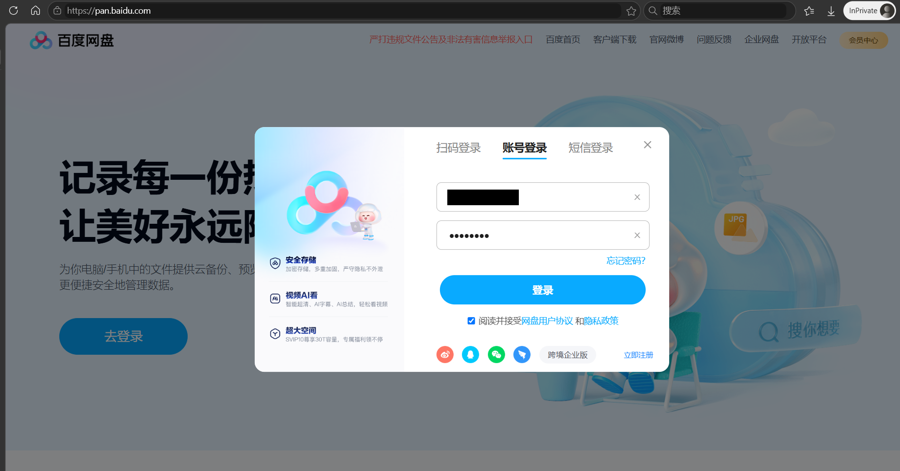
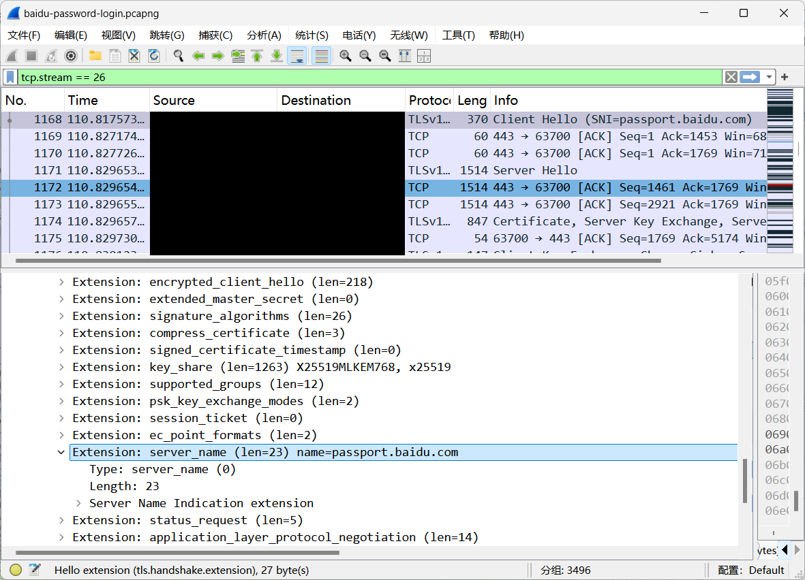
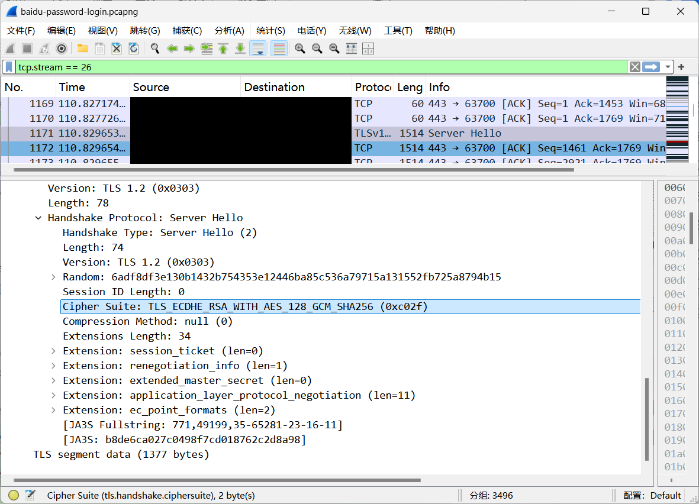
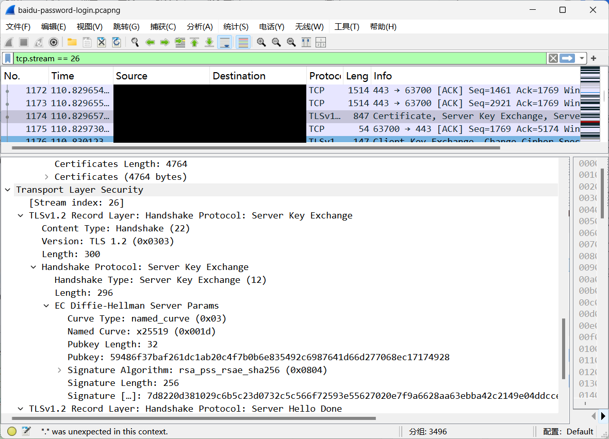
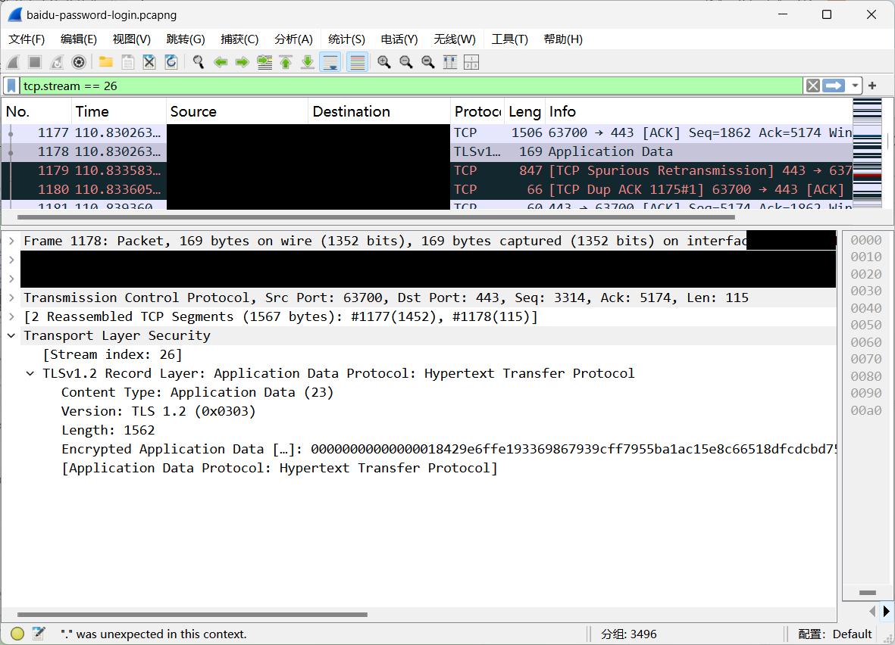

# 网络认证技术 作业二

## 一、RFC 阅读报告

阅读标准：RFC 4252《The Secure Shell (SSH) Authentication Protocol》。

### 1.1 要解决口令鉴别中的什么问题

RFC 4252 的 password 方法面向不可信网络中的远程主机登录：用户以用户名和口令证明身份，服务器需要判断该用户能否进入指定服务。此时的核心问题是，既要让服务器验证口令，又要避免口令在传输途中被窃听，并防止认证过程中的状态混淆。

传统的直接明文传输会把口令暴露给链路上的监听者；只给口令做一次简单编码也不能保护它。即使通信已经加密，如果客户端没有确认服务器身份，仍可能把口令交给冒充的服务器。此外，服务器不能把前一个用户的部分认证成功状态错误地累积到另一个用户身上。

RFC 4252 负责 SSH 的用户认证框架，支持口令、公钥等认证方法；密钥交换、服务器认证和传输加密主要由 RFC 4253 规定。这里聚焦 password 方法在安全通道内验证口令的场景，不把它当作独立的口令认证密钥交换协议。

### 1.2 如何解决：主要思路

主要思路是先建立经过服务器身份验证的安全通道，再在通道内提交和核验用户口令。客户端通过可信方式确认服务器主机密钥，SSH 传输层完成密钥交换，提供机密性与完整性保护；随后 RFC 4252 定义的用户认证协议才开始工作。若用户盲目接受错误的主机密钥，后续加密也无法保证口令交给了正确的服务器。

认证交互可概括为四步：

1. SSH 传输层建立安全通道，客户端请求 ssh-userauth 服务。

2. 客户端发送 SSH_MSG_USERAUTH_REQUEST，明确用户名、认证后需要访问的服务和认证方法；采用口令时，方法名为 password。

3. 服务器按本地账户策略核验口令，只有所有必需的认证条件均满足时才发送SSH_MSG_USERAUTH_SUCCESS；失败时发送 SSH_MSG_USERAUTH_FAILURE，并列出可以继续尝试的方法。

4. partial success 表示某一步认证已成功，但整体尚未完成。用户名或服务名改变时，服务器必须清除已累积的认证状态，避免把不同身份或服务的认证结果混用。

普通口令认证请求中的字段如下，顺序具有协议含义。

| 字段 | 含义 |
| --- | --- |
| byte SSH_MSG_USERAUTH_REQUEST | 用户认证请求，消息号 50 |
| string user name | 需要登录的用户 |
| string service name | 认证后访问的服务，如 ssh-connection |
| string method name | 固定为 password |
| boolean FALSE | 普通认证，没有携带新口令 |
| string password | 以 UTF-8 编码的口令明文 |

表中的“明文”是口令在认证消息中的表示形式，整个消息随后由 SSH 传输层加密，因此不等于在网络上明文发送口令。UTF-8 是字符编码，不是加密算法。若传输层不提供机密性，标准建议禁用口令认证；若缺少机密性或消息认证码 MAC，标准建议禁用口令修改。MAC 用于检测消息是否被篡改。

口令过期时，服务器应发送 SSH_MSG_USERAUTH_PASSWD_CHANGEREQ，且不得允许过期口令完成认证。客户端可以选择其他方法，或将请求标志置为 TRUE，携带旧口令和新口令完成修改。这些字段同样依赖安全通道保护。

因此，该方案通过“安全传输层保护口令、认证层核验身份并管理状态”的分工完成鉴别。password 方法本身没有单独设计口令挑战响应，也没有规定一种固定的口令数据库存储算法。

### 1.3 遗留了什么问题

1. 弱口令和在线猜测仍然存在。第 4 节建议限制认证时间和单连接失败次数，但攻击者仍可新建连接或分布式尝试，还需要跨连接限速和异常检测等措施。

2. 服务器仍可获得原始口令。安全通道保护的是传输过程，不能使口令对认证服务器保密；服务器失陷或终端存在恶意软件时，口令依然可能被窃取。

3. 口令存储安全未统一解决。标准没有强制一种加盐、慢速口令哈希方案，不能从“使用 SSH”推断账户数据库安全。

4. 服务器信任可能配置错误。首次连接时接受伪造主机密钥，或忽略主机密钥变更告警，都会破坏安全通道连接到正确服务器的前提。

5. 多因素认证和登录后的会话安全仍需额外策略。支持多种认证方法不等于默认要求多因素认证；认证完成后仍需访问控制、终端保护和会话管理。

## 二、口令登录抓包实验

### 2.1 实验目标与对象

实验目标是分析百度网盘网页 https://pan.baidu.com/ 的口令登录过程，判断网络传输是否加密，并识别实际协商的算法。图 1 为“账号登录”界面，账号信息已经遮盖，口令以圆点显示。

图 1 百度网盘账号登录页面，显示分析对象和口令登录方式。

口令圆点只是界面隐藏，是否进行传输加密需由报文判断。本实验关注操作期间出现的百度账号域名 passport.baidu.com。网页使用 HTTPS/TLS，与阅读部分的 SSH 属于不同协议；两部分比较的是安全通道内完成口令鉴别的思路，不认为百度网盘使用 RFC 4252。

### 2.2 抓包环境

| 项目 | 实际记录 |
| --- | --- |
| 系统 | Windows 11 23H2，64 位，build 22631 |
| 抓包工具 | Wireshark 工具套件 4.6.9，Dumpcap 捕获、TShark 解析 |
| 捕获驱动 | Npcap 1.88 |
| 捕获接口 | 以太网，Realtek Gaming GbE Family Controller |
| 数据规模 | 3,496 包，首末包间隔约 190.716 秒 |

### 2.3 实验步骤

（1）检查 Wireshark、Npcap 和接口列表，确认实际联网接口。短时测试曾在“以太网 2”捕获到 0 包；改用与活动地址匹配的“以太网”后成功捕获测试握手。

（2）在正式登录操作前启动捕获，设置下列捕获过滤器。条件包含 TCP 和 UDP 的 443 端口，以免预先排除可能使用 QUIC 的 HTTPS 连接。

(tcp port 443 or udp port 443) and
(host pan.baidu.com or host passport.baidu.com)

（3）打开百度网盘，选择账号密码方式并自行完成操作，反馈为“已完成口令登录”。本次未收集实际口令、验证码或 TLS 会话密钥；报告中的登录页面仅保留脱敏账号信息。

（4）登录操作后停止捕获，保存为 baidu-password-login.pcapng。原始包及分析记录位于同级“实验过程记录”目录，仅在本机留存。

（5）在 Wireshark 中按 ClientHello 的 SNI 查找账号域名，再按 tcp.stream 关联同一连接。SNI 是客户端在 TLS 握手中提供的服务器名称。本次可见 10 条 passport.baidu.com 的 ClientHello，选取握手字段完整的 tcp.stream == 26，显示过滤器为：

tcp.stream == 26

host 捕获条件按启动时的 DNS 结果匹配 IP，并不逐包匹配域名；共享 IP 上其他域名的流量也可能进入文件。因此不能把整个文件中的所有包都算成登录请求，还需要用 SNI 和流编号确认对象。

### 2.4 关键报文及口令传输分析

以下时间均为相对于捕获文件首包的秒数，帧号直接对应正式原始文件。每项依次列出报文类型、帧号和时间，并紧接该帧截图与分析。

#### 2.4.1 ClientHello：帧 1168，时间 110.817573 s

图 2 帧 1168 的 ClientHello，展开服务器名称和候选版本。

server_name 为 passport.baidu.com，说明这条 TLS 连接面向百度账号服务，可将它与本次网盘登录操作关联。supported_versions 同时提供 TLS 1.3 和 TLS 1.2；key_share 中出现的算法也只是客户端提供的能力，最终版本和算法仍要查看 ServerHello，不能据此直接认定使用 TLS 1.3。

#### 2.4.2 ServerHello：帧 1171，时间 110.829654 s

图 3 帧 1171 的 ServerHello，高亮服务端选定的密码套件。

服务端选定 TLS 1.2，套件为 TLS_ECDHE_RSA_WITH_AES_128_GCM_SHA256，编号 0xC02F。这确认了本连接的协商结果，而非上一帧中列出的候选能力。ECDHE 用于临时密钥交换，RSA 表示服务器握手签名认证，AES_128_GCM 用于记录层认证加密，SHA256 对应本套件的 TLS 伪随机函数所用哈希。

AES-GCM 同时保护数据机密性和完整性。套件中的 SHA256 不能证明口令经过 SHA-256 处理，也不能证明服务端使用 SHA-256 存储口令；这些属于应用层或存储层问题。

#### 2.4.3 Server Key Exchange：帧 1174，时间 110.829658 s

图 4 帧 1174 的 Server Key Exchange，展开曲线和握手签名字段。

本帧重组后的解析内容包含 Certificate、Server Key Exchange 和 Server Hello Done。Named Curve 为 x25519（0x001D），表明本次临时密钥交换采用 X25519；在临时秘密妥善生成和销毁等条件下，ECDHE 可提供前向保密。Signature Algorithm 为 rsa_pss_rsae_sha256（0x0804），是服务器握手签名，用于认证交换参数，不是用 RSA 直接加密全部业务数据。

证书链签名和 Server Key Exchange 签名是不同字段。本帧中可以同时出现证书相关的 ECDSA 签名和握手的 RSA-PSS 签名，不能把二者当作相互矛盾的业务加密算法。随后帧 1176（110.830124 s）可解析出 Client Key Exchange、Change Cipher Spec 和加密握手消息，表示客户端继续完成密钥交换并切换到协商的保护状态。

#### 2.4.4 Application Data：帧 1178，时间 110.830264 s

图 5 帧 1178 的 TLS Application Data，应用内容显示为密文。

Encrypted Application Data 说明应用内容已处于 TLS 加密记录中。界面下方的 Hypertext Transfer Protocol 提示不等于已解密 HTTP 请求体；当前无法从本图读取 password 参数，也不能单凭该包的长度、时间或域名把它认定为具体的口令提交请求。

帧 1183（110.839362 s）还可见服务端 New Session Ticket、Change Cipher Spec 和加密握手消息。结合这些报文，可以确认所选百度账号连接使用 TLS 1.2、X25519、RSA-PSS-SHA256 握手签名和 AES-128-GCM 记录保护。捕获中另有乱序、重传和缺段提示，本报告只引用能完整解析的握手字段，不宣称整个捕获文件无丢包。

### 2.5 实验结果及分析边界

我完成了“打开网站、选择账号密码方式、提交并登录”的操作；数据包则显示操作期间存在面向百度账号域名的 TLS 握手和后续双向加密应用数据。登录成功来自我的确认，尚未从解密后的服务端业务响应中复核。

| 分析问题 | 本次结果 |
| --- | --- |
| 网络传输是否加密 | 已确认样本连接使用 TLS 1.2 和 AES-128-GCM，应用内容为加密 Application Data |
| 哪一包是精确的口令提交请求 | 尚未确认；未解密 HTTP，无法直接定位具体登录请求体 |
| 能否从常规抓包解析读取口令明文 | 本次未能读取；这与 TLS 保护一致，但不等于终端和服务端均无泄露风险 |
| 服务端怎样存储口令 | 抓包无法确定，不能由传输算法推断存储算法 |

本次成功取得真实网络数据，分析停在“TLS 密文无法还原具体口令登录请求体”这一层。若要继续确定前端是否对口令额外做 RSA 加密或哈希，需要在受控客户端中定位实际登录请求和前端处理代码，或取得必要的会话解密证据，再保存脱敏分析结果。

阅读与实验共同表明，安全通道可以保护口令传输，但弱口令、服务器信任和口令存储仍需分别处理。分析登录安全时，应分别判断客户端候选能力与服务端选择、握手签名与记录加密，以及传输保护与应用层口令处理，明确每个结论的证据范围。
